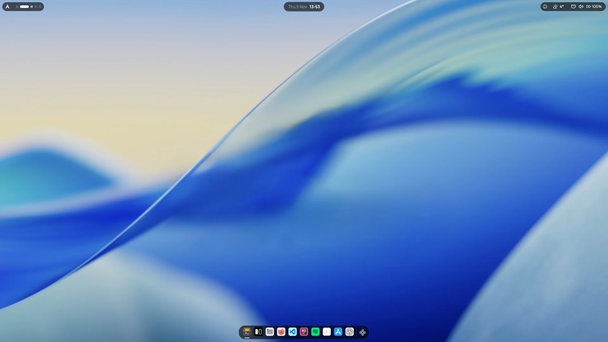
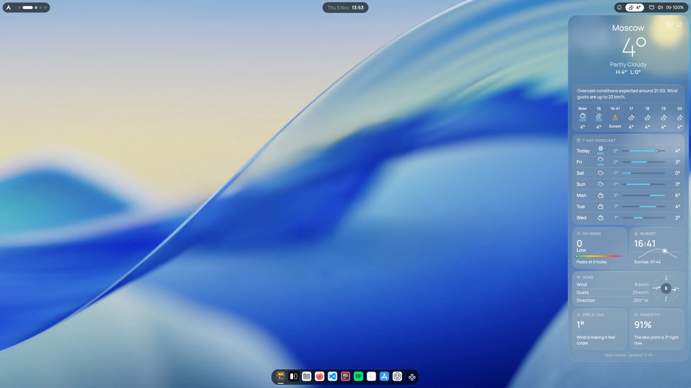
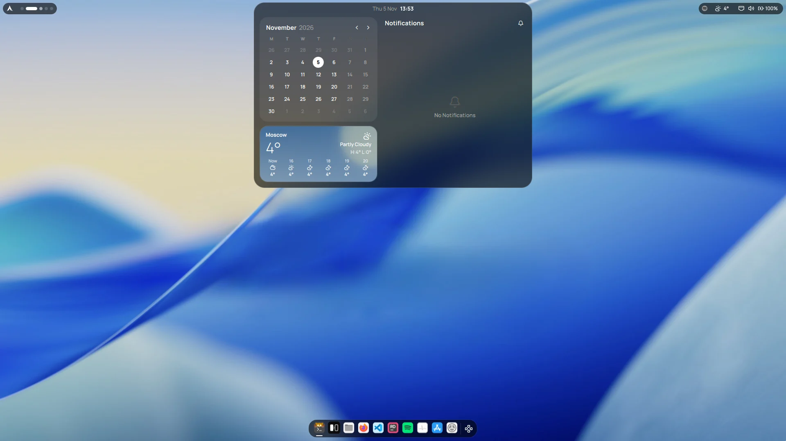
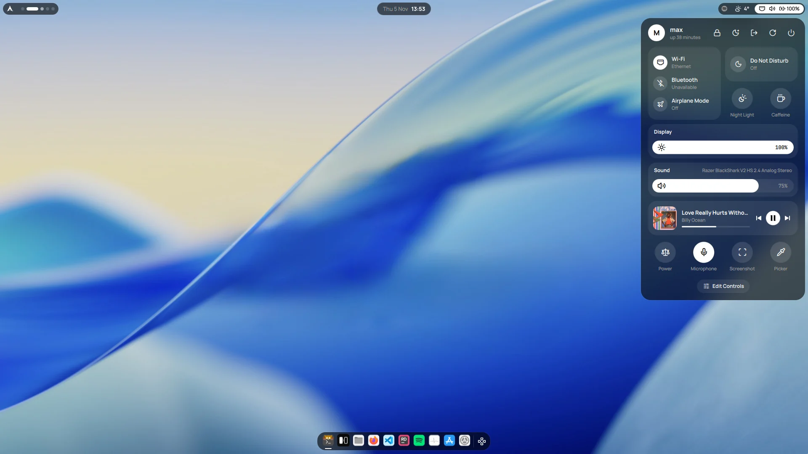
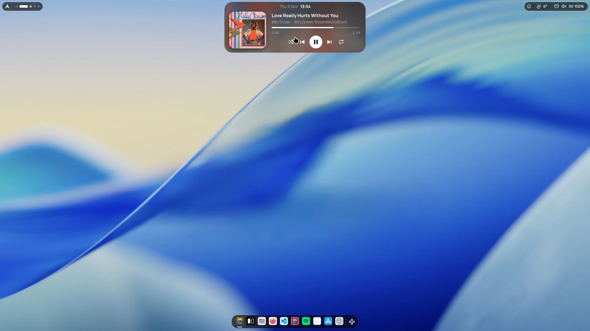
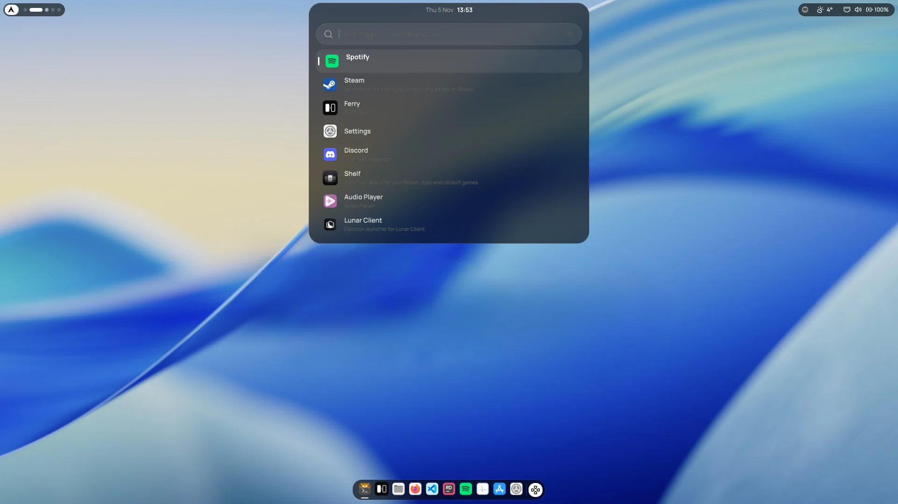
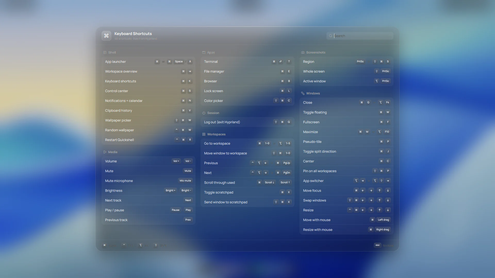

# dotfiles

Monochrome, macOS-ish Hyprland rice for Arch Linux, with a frosted-glass
[Quickshell](https://quickshell.org) shell.



<table>
  <tr>
    <td></td>
    <td></td>
  </tr>
  <tr>
    <td></td>
    <td></td>
  </tr>
  <tr>
    <td></td>
    <td></td>
  </tr>
</table>

## Install

```sh
git clone https://github.com/0xby7eMe/dotfiles ~/dev/dotfiles
cd ~/dev/dotfiles
./install.sh        # --dry-run to see every step first
```

## Keys

| | |
| --- | --- |
| `Super` `Space` | launcher |
| `Super` `S` | control center |
| `Super` `N` | notifications + calendar |
| `Super` `Tab` | overview |
| `Super` `Shift` `W` | wallpapers |
| `Super` `K` | all shortcuts |

More in [docs/details.md](docs/details.md): what the installer does, NVIDIA
setup, the shell's IPC, and the repo layout.
